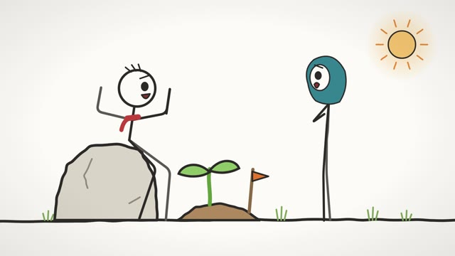
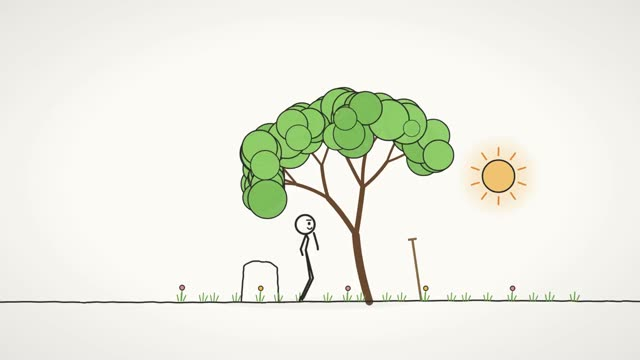
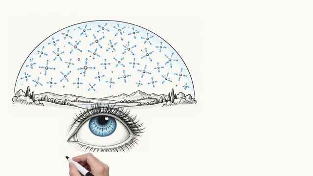
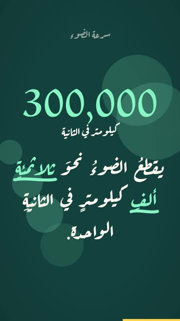

# create — مصنع فيديو بالكود لوكلاء الذكاء الاصطناعي

**افتح هذا المستودع بأيّ وكيل برمجة (Claude Code، Codex، Cursor، Gemini CLI، Viktor…) وقل له: «اصنع فيديو عن …».**
سيقرأ [`AGENTS.md`](AGENTS.md) ويصير منتج فيديو كاملاً: يكتب القصة، ويسجّل الأصوات، ويحرّك الشخصيات بحركة
ممثّلين حقيقيين، ويرسم بيد على لوح أبيض، ويؤلّف الموسيقى بالمقامات، وينتقد عمله، ثم يسلّم MP4.
كل ذلك **بالكود فقط**: بلا نماذج فيديو مدفوعة، والمفاتيح كلها اختيارية.

> **قرار المالك (2026-10-24):** أسلوب «حوار» معتمد ما عدا الصوت واللغة؛ **كل الأفلام الجديدة بالإنجليزية** (النص والأصوات والعناوين
> والترجمة). Owner decision: the «Hiwar» style is approved except voice and language — **all new films are in English**.

| | | | |
|---|---|---|---|
| [](gallery/hiwar.mp4) | [](gallery/albidhra.mp4) | [](gallery/sky.mp4) | [](gallery/light-speed.mp4) |
| **«حوار»**: شخصيتان تتكلّمان، شفاه ولقطات ومونتاج، 29 ث | **«البذرة»**: ستيكمان بموكاب حقيقي، 60 ث | **«لماذا السماء زرقاء؟»**: لوح أبيض، 63 ث | **«سرعة الضوء»**: موشن 9:16، 28 ث |

## أربعة أشكال جاهزة
- **ستيكمان سينمائي**: حركات من قاعدة CMU (أكثر من 2600 لقطة حقيقية) تُسقط على شخصية مرسومة بالحبر، ومعها
  دمج سلس بين الحركات، وطبقات تمثيل (برد، فرح، نظر)، ووجه بتعابير، وأدوات تمسكها اليد، وليل ومطر ونموّ شجرة، وكاميرا.
- **لوح أبيض**: يد حقيقية ترسم الأفكار على كلماتها، وعناوين بخط الرقعة تُكتب من اليمين، وجدارية تكشفها الكاميرا.
- **موشن تايبوغرافي**: كل كلمة تظهر لحظة نطقها، والأرقام تعدّ، بصيغة 9:16 لـ Shorts و Reels و TikTok.
- **فيلم حواري (كرتون)**: شخصيات بأصوات مختلفة (إنجليزية افتراضياً)، وأفواه تطابق الكلام (Rhubarb بالإنجليزية مع النص، أو قواعد الحروف العربية)، ومستمع حيّ
  يومئ ويتفاعل، وإيماءات على الكلمات المشدّدة، وقائمة لقطات بقطع حادّ (WS ← MS ← MCU ← CU)، ووقفات كوميدية، وترجمة بأسماء المتكلّمين.

## مهارات حِرفية للوكلاء
مجلّد [`skills/`](skills/README.md) فيه ستّ مهارات بصيغة Agent Skills يقرؤها الوكيل قبل كل مرحلة: كتابة الكرتون، تصميم
الشخصيات، الشخصيات المتكلّمة، الإخراج، المونتاج، تحريك الستيكمان. يجدها Claude Code وCodex وGemini تلقائياً.

## ابدأ
```bash
bash tools/doctor.sh && pip install -r requirements.txt && playwright install chromium
bash examples/albidhra/build.sh                                         # يبني مثالاً
python tools/render/snap.py examples/albidhra/proj sheet.png --every 5  # معاينة سريعة
bash tools/render/render.sh examples/albidhra/proj out/albidhra.mp4      # MP4 (HyperFrames)
python tools/new_film.py my-film --from albidhra                       # فيلمك الأول ← films/my-film
bash examples/hiwar/build.sh                                            # الفيلم الحواري (أصوات + شفاه + لقطات)
python tools/new_film.py my-talk --from hiwar                           # حوارك ← عدّل cast.json و scene.json ثم build.sh
```

## ما في الصندوق
| المجلد | المحتوى |
|---|---|
| `AGENTS.md` | دليل الوكيل: الدور، والقواعد الذهبية، واختيار الشكل، وخطّ الإنتاج، وبوّابة الجودة، والتسليم |
| `docs/recipe/` | الوصفة: القصة، والصوت، والستيكمان، واللوح الأبيض، والموشن، والموسيقى، والناقد، والتصدير |
| `docs/tools-landscape.md` | أدوات العالم المفتوحة (HY-Motion، Kimodo، Code2Video، Stable Audio 3…) وخارطة التطوير |
| `docs/lessons.md` | مطبّات حقيقية وحلولها |
| `skills/` | مهارات الوكلاء الحِرفية (كتابة، شخصيات، حوار، إخراج، مونتاج، تحريك) |
| `engine/` | `stickfilm.js` و`ink.js` و`talk.js` (تمثيل الحوار) و`shots.js` (لقطات ومونتاج): المحرّك (MIT) |
| `tools/` | الصوت والحوار ومزامنة الشفاه، والموكاب، والموسيقى، والرسوم، وقائمة اللقطات، والبناء، والمعاينة، والتصدير، والتحقّق |
| `examples/` | أربعة أفلام كاملة قابلة لإعادة البناء |

الترخيص MIT. المكوّنات الخارجية مذكورة في [`THIRD_PARTY.md`](THIRD_PARTY.md).
