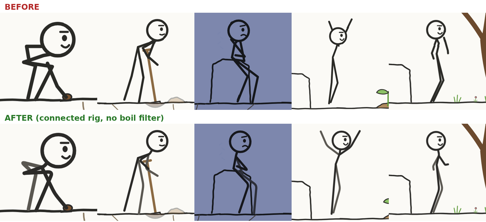

# 03 · فيلم الستيكمان (موكاب حقيقي + محرّك stickfilm)

السرّ: الإنسان يتحرّك بحركة **مسجّلة من ممثّل حقيقي** (قاعدة CMU المجانية، أكثر من 2600 لقطة)، تُسقَط من منظر
جانبي على شخصية ستيكمان، ثم تضاف فوقها طبقات «تمثيل» بالكود (وضعيات، ووجه، وتنفّس، وارتجاف).

## 1. اختيار الحركات
```bash
python tools/mocap/search.py dig shovel           # أو: --all sad walk ، --subject 79
```
المواضيع الذهبية: 79 و80 (تمثيل صامت: حفر، زرع، التقاط، برد، فرح، حزن…)، و82 (مشي بمشاعر)،
و13 و14 (جلوس وأفعال يومية)، و26 (انحناء والتقاط)، و02 (مشي)، و09 (جري)، و05 (رقص)، و141 (إيماءات).
الإطار 0 في CMU وضعية T، فابدأ من 20–40 فما فوق.

## 2. التحويل والفحص
اكتب `clips.json` (راجع docstring في `tools/mocap/prep_clips.py`)، ثم:
```bash
python tools/mocap/prep_clips.py clips.json film_clips.js     # يحمّل ويحوّل ويطبّع الأرض ويجد دورة المشي
python tools/mocap/sheet.py sheet.png film_clips.js           # انظر إليها
```
- `--view travel` للمشي (منظر جانبي على اتجاه السير)، و`--view side --vframe N` للأفعال في المكان (يُقاس الاتجاه
  من خط الوركين في الإطار N، فاختر إطاراً يقف فيه الممثّل مستقيماً).
- `keep_drift: true` يحفظ الانتقال الحقيقي فلا تنزلق القدمان.
- إن ظهر الممثّل في الصفحة من الأمام أو الخلف فغيّر `vframe` أو `view`.

## 3. كتابة الفيلم (`film.js`)
انسخ `examples/albidhra/film.js` وعدّل الأقسام:
- **SEG**: مقطع لكل حدث `{t0, t1, clip, from, to}` أو `hold` أو `loop`، مع `f:-1` للالتفات، و`blend` للدمج
  السلس (0.35–0.45 ث)، و`id` و`snap` للعودة إلى المكان نفسه. المخطِّط يسلسل مواضع x تلقائياً، و`anchor` يثبّت مقطعاً.
- **طبقات التمثيل** في `figJoints(t)`: `M.pose(J, {haR: ["neck", 62, -4]}, w)` تضع اليد بالنسبة إلى مفصل آخر
  (الإزاحة x تتبع اتجاه الوجه). أوزان `ramp()` للدخول والخروج. أمثلة جاهزة: النظر إلى الكفّ، احتضان النفس من البرد
  مع الارتجاف، رفع الذراعين فرحاً مع القفز، التنفّس عند الوقوف، رفع الرأس.
- **الوجه** `EXPR`: `[t, فم (-1 حزين … 1 فرح، > 0.92 مفتوح), حاجب (+ قلق، - عزم), حجم العين]`، و`BLINKS` للرمش.
- **المشهد والأدوات**: تُربط الأدوات بالمفاصل (البذرة في اليد، المجرفة بين اليدين). اللحظات تُشتقّ من الموكاب
  (`M.timeOf(seg, clip.low.frame)` = لحظة وصول اليد إلى الأرض)، فلا تخمّن الأوقات.
- **الكاميرا** `CAM`: مفاتيح `[t, () => [x, y, zoom]]`، والتكبير على اللحظات العاطفية (1.3–1.45×)، والسحب للخلف في النهاية.
- **العالم**: `drawPath()` يرسم بقلم يتحرّك، و`Ink.path()` للخطوط المرتعشة، وطبقة `#night` (multiply) لليل،
  وطبقة سماء فوقها للقمر والمطر.

## 4. البناء والمعاينة
```bash
python score.py                         # الموسيقى → proj/assets/mix.wav
python ../../tools/build/build.py .     # template.html + film.js → proj/index.html (+ engine + fonts)
python ../../tools/render/snap.py proj sheet.png --every 2.5
```
ثم بوّابة الناقد (`07-critic.md`).

## 5. شخصية متّصلة بحواف ناعمة (rig v2)


المشكلة القديمة: الذراعان تُرسمان من مفصلَي الكتف في CMU، وهما في الإسقاط الجانبي يبعدان 25–60 وحدة عن العمود الفقري،
فتبدو الذراع **منفصلة** عائمة بجانب الجسم أو فوق الرأس. وفلتر «الغليان» (`feDisplacementMap`) على الشخصية جعل
**الحواف مسنّنة**. الحلّ في `StickFilm.rig` (مفعّل افتراضياً):
- **جسم واحد متّصل**: الذراعان تخرجان من أعلى العمود الفقري (`shoulder: 0.1` من العنق نحو الورك)، والساقان من الورك،
  والعنق يلتقي بحافّة دائرة الرأس في اتجاهه (لا يخترق الوجه).
- **اليدان والقدمان لا تتحرّكان**: تبقى حيث وضعها الموكاب أو طبقات التمثيل، فالأدوات المربوطة باليد تبقى في مكانها.
  يتحرّك المرفق والركبة نصف إزاحة الجذر فقط، وهي دالّة خطّية في المفاصل، فلا قفزات ولا انقلاب للمرفق.
- **مفاصل مستديرة**: قوس قصير عند المرفق والركبة والعنق (`round: 0.3`).
- **عمق**: `backInk: "#5a5751"` يلوّن الذراع والساق البعيدتين (L) بحبر أفتح قليلاً، فتُقرأ الأطراف المتقاطعة.
- **بلا فلتر على البطل**: لا تمرّر `filter: "url(#boil)"` إلى `rig`. اترك الغليان للأرض والأشياء.
- `connect: false` يعيد الرسم القديم إن احتجته.

## مطبّات معروفة
- وضعيات الذراعين فوق الرأس: ثبّتها على `neck` واجعلها واسعة (±100 أفقياً) وإلا مرّت خلف الرأس كقرنَي استشعار.
- الجلوس في CMU على كرسي: ارسم صخرة تحت الوركين خلف الشخصية.
- الجذع قصير عند الجلوس، فوضعيات اليدين على الصدر تتزاحم. كبّر الكاميرا أو بسّط الوضعية.
- عند الدخول قد يمرّ البطل أمام الصخرة: رتّب المشهد بحيث لا يتقاطع المسار مع الأشياء.
